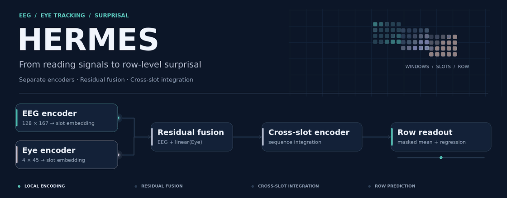
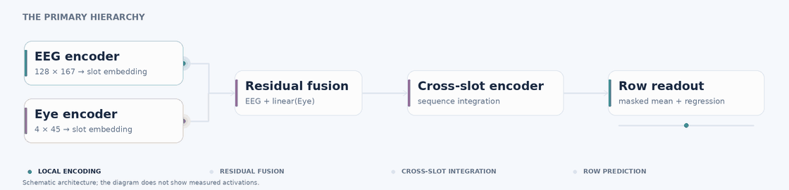
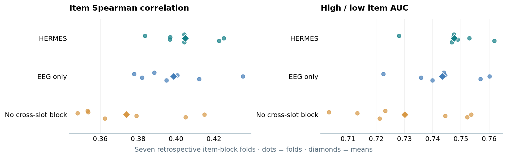
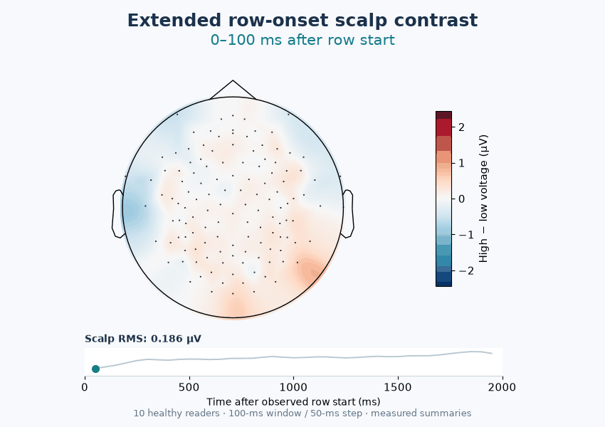
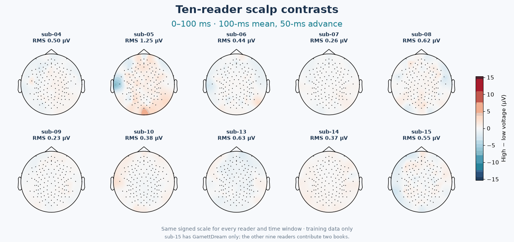

<div align="center">



<p><strong>Hierarchical EEG and Eye Modeling of Row-Level Surprisal in Chinese Reading</strong></p>

<a href="https://www.python.org/"></a>
<a href="https://pytorch.org/"></a>
<a href="https://openneuro.org/datasets/ds004952"></a>
<a href="CITATION.cff"></a>

<p><a href="#model">Model</a> · <a href="#results">Results</a> · <a href="#quick-start">Quick start</a> · <a href="#supplementary-materials">EEG animations</a> · <a href="docs/REPRODUCIBILITY.md">Reproducibility</a></p>

</div>

<table align="center">
<tr>
<td align="center"><sub>ITEM SPEARMAN ρ</sub><br /><strong>0.405 ± 0.015</strong></td>
<td align="center"><sub>HIGH / LOW ITEM AUC</sub><br /><strong>0.748 ± 0.010</strong></td>
<td align="center"><sub>ARCHIVED DATA</sub><br /><strong>11,037 text rows · 102,499 readings</strong></td>
</tr>
</table>

HERMES predicts a frozen language model's mean token surprisal for a displayed Chinese text row from EEG and eye tracking. The decoder receives signal windows and slot masks at inference. Text is used to construct the targets. HERMES is the name of the archived `MM_mid` implementation.

The headline values summarize **seven retrospective item-block rotations**. Readers recur across folds, and the blocks were used during model development. They do not establish generalization to new readers or timing-independent decoding.

## Model



| Within each slot | Across the row |
| :-- | :-- |
| **EEG:** 128 × 167 samples, nominal −100 to +1200 ms | **Fusion:** EEG embedding + zero-initialized linear Eye residual |
| **Eye:** gaze x/y, pupil and validity; 4 × 45 samples, −100 to +800 ms | **Integration:** cross-slot sequence encoder and masked mean pooling |
| **Encoding:** separate temporal encoders; mean/max summaries projected to 96 dimensions | **Output:** one row-surprisal regression score |

[Architecture source](src/foundation/hiernet.py) · [Training entry](scripts/run_charbag_cv.py) · [Data and protocol guide](docs/REPRODUCIBILITY.md)

The motion graphics illustrate computation flow. Their moving elements are schematic, rather than recorded waveforms or measured activations.

## Results



| Archived model | Reading ρ | Item ρ | Item AUC |
| :-- | --: | --: | --: |
| **HERMES · EEG + Eye** | **0.354 ± 0.019** | **0.405 ± 0.015** | **0.748 ± 0.010** |
| Matched EEG only | 0.354 ± 0.021 | 0.399 ± 0.020 | 0.743 ± 0.013 |
| No cross-slot encoder | 0.261 ± 0.027 | 0.374 ± 0.027 | 0.730 ± 0.020 |
| Historical resampled-row EEG | 0.192 ± 0.031 | 0.310 ± 0.039 | 0.696 ± 0.024 |

Values are fold mean ± standard deviation. Item scores average predictions across readers of the same row. AUC uses the outer surprisal terciles with training-derived boundaries. The historical row model changes both representation and network.

[Fold tables and predictions](results/tables/) · [Additional metrics](results/diagnostics/) · [Editable result figure](docs/assets/archived_results.svg)

<details>
<summary><strong>Protocol and matched controls</strong></summary>

- The archived model used pooled unlabeled Eye statistics. Training-only fusion reaches item ρ ≈ **0.397**, versus **0.399** for EEG only; eye-regression correction reaches ≈ **0.396**. The tested Eye contribution does not persist under these controls.
- Item correlation falls to ≈ **0.178** after conditioning on book and valid-character count.
- Estimated slot centers, overlap geometry, slot masks and absolute gaze can retain presentation information. Equal EEG/Eye endpoints do not consistently improve the matched validation scores.
- Continuous-source noise and fixed-grid controls use their own inputs and cohorts. Their scores are reported separately.
- The original multimodal launch options and weights were not fully retained. Recomputing archived metrics and retraining the original weights are different reproduction tasks.

[Protocol details](docs/REPRODUCIBILITY.md) · [Control records](results/eye_clean_decoder_20260930/) · [Research history](docs/research_history.md)

</details>

## Quick start

### Install

```bash
git clone https://github.com/naolab205/HERMES-Surprisal.git
cd HERMES-Surprisal
python -m venv .venv
source .venv/bin/activate
python -m pip install -r requirements.txt
```

### Verify the archived results

```bash
python scripts/evaluate_surprisal_predictions.py \
  results/tables/charbag_MM_mid_predictions.csv \
  --out-dir outputs/primary_metrics

python scripts/plot_release_overview.py
```

These commands recompute metrics from saved predictions and redraw the result figure. **No EEG download or new training is required.** Conditional book/count metrics additionally require cache metadata; their archived records are included.

<details>
<summary><strong>Train with locally prepared signal caches</strong></summary>

Obtain [ChineseEEG / ds004952](https://openneuro.org/datasets/ds004952) and follow the [signal-cache requirements](docs/REPRODUCIBILITY.md#signal-caches). Large EEG/Eye caches and trained checkpoints are not included. Some historical preprocessing utilities require local path adaptation. CUDA is recommended for training; `bsdtar` is needed to read the eye-tracking archives.

```bash
export CHINESEEEG_ROOT=/path/to/ds004952
export SURPRISAL_EEG_CACHE=/path/to/eeg_cache
export SURPRISAL_EYE_CACHE=/path/to/eye_cache

python scripts/run_charbag_cv.py \
  --arm HERMES_train_stats \
  --arch mmhier --seq-block modern --csd \
  --cache-dir "$SURPRISAL_EEG_CACHE" \
  --eye-stats-scope train \
  --folds 0 1 2 3 4 5 6 --seed 2026 \
  --device cuda:0 --out-dir outputs/hermes_train_stats
```

New runs use training-only eye statistics. The archived `MM_mid` result used `--eye-stats-scope global`. Changing normalization or sampling defines a different experiment; the command above does not promise 0.405. Add `--no-eye` for the matched EEG-only architecture. Use a fresh output name to retain existing evidence.

[Environment used for release checks](docs/environment_tested.txt) · [Reproduction boundaries](docs/REPRODUCIBILITY.md)

</details>

## Supplementary materials

**Two recorded-EEG animations** accompany manuscript Appendix A. They cover **0–2000 ms** using 39 measured 100-ms means advanced by 50 ms, shown at 100 ms per frame.

| Material | What it adds |
| :-- | :-- |
| [**S1 · Group contrast**](docs/appendix/extended/README.md#s1--time-course-of-the-row-level-eeg-contrast) | The time course of the high-minus-low row-surprisal voltage contrast |
| [**S2 · Reader contrasts**](docs/appendix/extended/README.md#s2--between-reader-variation) | Signed spatial and temporal differences across ten healthy readers |

<details>
<summary><strong>Play the two EEG animations</strong></summary>

<p align="center"></p>
<p align="center"></p>

Nine readers contribute both books; sub-15 contributes GarnettDream only. This ten-reader extension differs from the balanced nine-reader main analysis. Overlapping windows are not independent observations. These training-data summaries provide descriptive context, without model attribution or another test of generalization.

[Definitions, source arrays and reproduction](docs/appendix/extended/README.md)

</details>

## Repository guide

| Entry | Contents |
| :-- | :-- |
| [`src/`](src/) · [`scripts/`](scripts/) · [`tests/`](tests/) | Model, training, preprocessing utilities and policy checks |
| [`data_cache/`](data_cache/) | Frozen numerical labels, spatial matrix and cache audits |
| [`results/`](results/) | Predictions, fold tables and control evidence, including failed candidates |
| [`analysis/`](analysis/) | Analysis code and scientific source arrays |
| [`docs/REPRODUCIBILITY.md`](docs/REPRODUCIBILITY.md) | Setup, cache dependencies and evidence map |
| [`docs/research_history.md`](docs/research_history.md) | Experiment history and links to frozen reports |

<details>
<summary><strong>Static graphics and animation sources</strong></summary>

[Static header](docs/assets/hero_animated_still.png) · [Static architecture](docs/assets/architecture_animated_still.png) · [Vector result figure](docs/assets/archived_results.svg)

```bash
python scripts/build_readme_animations.py
python scripts/build_extended_scalp_animations.py
```

The first command renders the conceptual header and architecture. The second reproduces the measured supplementary animations. Their roles and sources are documented in [PROVENANCE.md](docs/PROVENANCE.md).

</details>

## Citation and contact

Use [CITATION.cff](CITATION.cff) to cite the software. Authors: **Chenggong Zhong, Shiqi Li, Weijie Luo, Jinke Luo and Yao Miao**. Correspondence: **miaoyao@sztu.edu.cn**.

ChineseEEG and the frozen language model retain their own attribution and usage terms. A repository-wide code license has not yet been designated. Publication details will be added when available.
