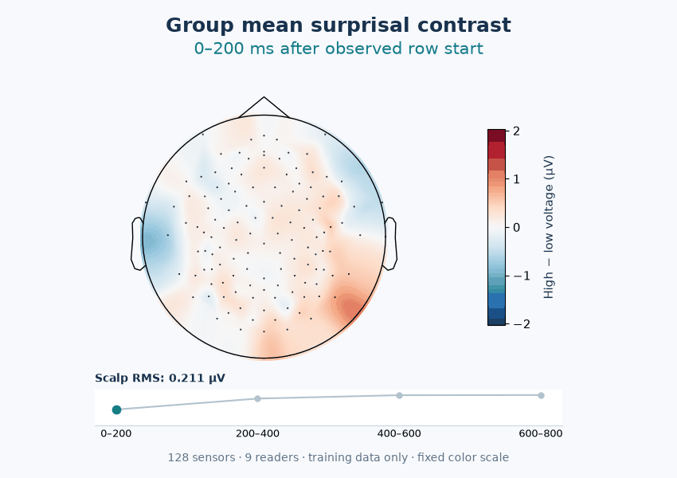
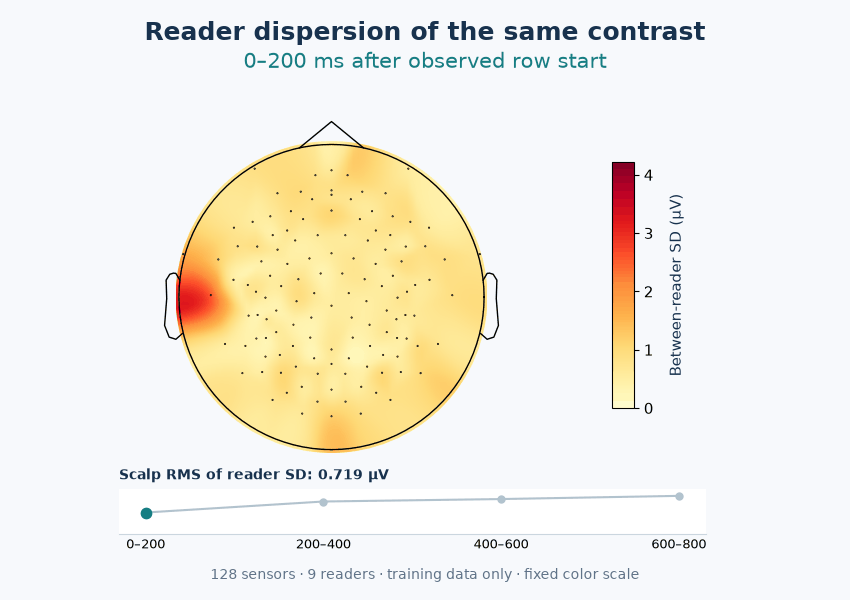

# Appendix: scalp dynamics from the manuscript data

These are measured training-data summaries associated with manuscript Figures 5 and 7. They are separate from the conceptual README flow animations.

For a longer and faster display with all ten available readers, see the [0–2000-ms, 39-frame extension](extended/README.md). Its available-book cohort is documented separately from the balanced nine-reader analysis below.

## Animation S1 · Group high-minus-low contrast



**Question:** How does the signed group scalp contrast change between 0 and 800 ms after an observed row start?

The four frames show 0–200, 200–400, 400–600, and 600–800 ms window means. The fixed range is −2.03 to +2.03 µV. Group scalp RMS is 0.211, 0.357, 0.403, and 0.404 µV, matching Figure 5 in the manuscript.

[All four static frames](topography/group_contrast_keyframes.pdf) · [First-frame preview](topography/group_contrast_poster.png)

## Animation S2 · Between-reader dispersion



**Question:** Where does the group average hide differences between readers?

Each frame is the sensor-wise sample standard deviation across the nine signed reader-level contrasts, with `ddof=1`. The fixed range is 0–4.22 µV. The scalp RMS of this SD is 0.719, 1.088, 1.170, and 1.277 µV. This adds spatial context to the reader RMS clustering in Figure 7. SD describes dispersion, not the uncertainty of the group mean, a prediction score, or a hypothesis test.

[All four static frames](topography/reader_dispersion_keyframes.pdf) · [First-frame preview](topography/reader_dispersion_poster.png)

## Shared data and interpretation

The source is [`analysis/verified_revision_20261007/row_onset_topography.npz`](../../analysis/verified_revision_20261007/row_onset_topography.npz), not the older character-window map arrays. These exact arrays generated the manuscript's current row-onset maps and reader RMS features. Nine readers with both books contribute equally. The analysis uses setting-0 training blocks 2–6, ten complete slots per reading, within-book training terciles, and a 13-sample pre-row reference. Voltages are before the decoder's CSD transform.

Every frame holds for 1.5 seconds. There is **no temporal interpolation**. The maps use MNE spatial interpolation between the 128 sensors with the same display montage as Figure 5. The time-course line connects four measured RMS summaries and does not represent a sampled EEG time series. The displays do not establish character-locked N400 responses, model attribution, or independently tested reader subtypes.

## Reproduce

```bash
python scripts/build_topography_appendix.py
```

No raw EEG download is needed to redraw these summaries. The script uses the included numerical arrays and electrode coordinates. See [provenance](topography/provenance.json), [window summary](topography/window_summary.csv), and [plot-ready arrays](topography/animation_source_arrays.npz) for exact values, input hashes, and display settings. These files permit reproducing the supplementary displays; re-extracting their source contrasts from recordings requires the original preprocessing inputs described in the manuscript.
