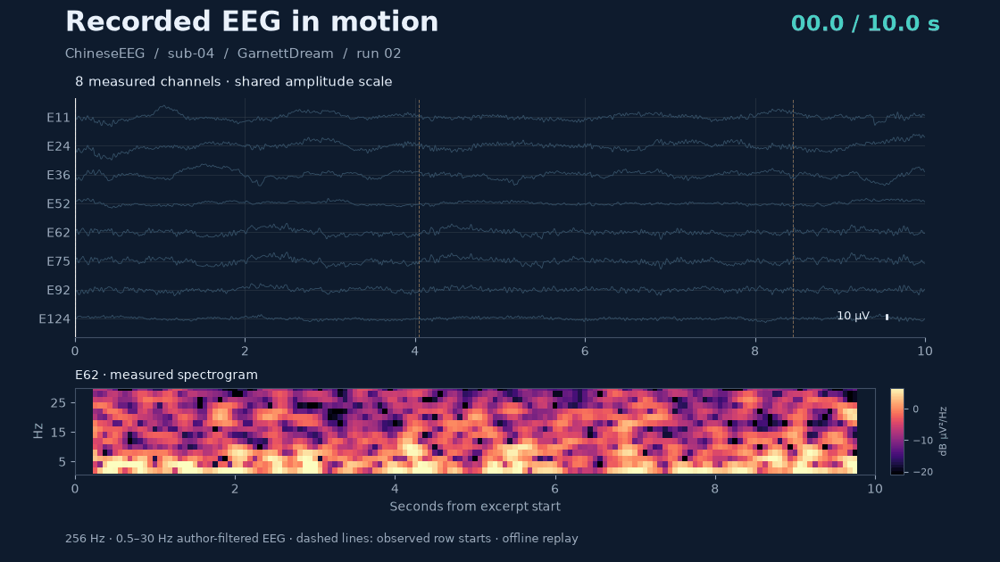
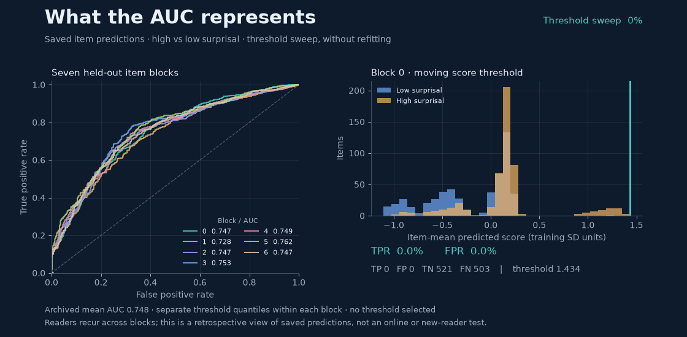

# Recorded signals and archived predictions

These two README animations answer different questions. The EEG replay shows
what a short recorded input looks like over time. The prediction display shows
how score thresholds change the classification trade-off behind the reported
AUC. Neither display shows model attention or learned sensor attribution.

## Recorded EEG replay



The source is ChineseEEG, OpenNeuro `ds004952`: **sub-04, GarnettDream, run 02**,
using the dataset authors' `filtered_0.5_30` continuous recording. We select the
first recording in the existing training-only extraction audit and begin at
its first prefix-checked row. Signal amplitude and prediction accuracy do not
select the example.

The excerpt contains **10 seconds at 256 Hz**, with eight measured channels:
E11, E24, E36, E52, E62, E75, E92 and E124. No samples are synthesized,
resampled, clipped or additionally filtered. Display traces subtract their own
excerpt medians and use vertical offsets with **one common microvolt scale**.
They are not separately normalized to look equally active. Dashed markers are
observed row starts from the source event file. The continuous interval spans
several displayed rows, so it is not presented as a single character response.

The lower panel is E62 power spectral density, computed offline with a Hann
window of 128 samples and a 16-sample advance. The display uses 0.5–30 Hz axes
and fixed color limits at the second and 98th percentiles of the excerpt's
log-power values. The 0.5-second spectral window gives 2-Hz frequency bins.
The full spectrogram is available throughout the replay; this is not a causal
online spectral estimator. The cursor and highlighted trail advance across
measured samples. The GIF contains 128 frames, normally held for 80 ms, with
an 800-ms final pause. Its playback loop is 10.96 seconds.

This example connects the model's fixed-duration windows to the continuous
recording from which windows are extracted. It illustrates signal variability
and row boundaries. It does not verify character-trigger alignment or show
that a visible feature predicts surprisal.

## Archived prediction threshold sweep



The source is the unchanged
[`charbag_MM_mid_predictions.csv`](../../results/tables/charbag_MM_mid_predictions.csv).
Reader predictions are averaged for each item within its held-out block.
Stored training-derived tercile labels define high and low surprisal; middle
items are excluded. These are the same definitions used for the manuscript's
item AUC.

The left panel contains **seven empirical ROC curves**. Markers advance through
score thresholds set separately within each block. The right panel shows the
two score distributions for **block 0**, its threshold, and its true/false
positive and negative counts. Every displayed count is calculated from the
saved item predictions. The threshold sweep includes both all-negative and
all-positive endpoints. It does not select an operating threshold or fit a
classifier.

The seven AUC values match the frozen fold table within `1e-12`; their mean is
**0.7476007066**, or **0.748** after rounding. The 100 animation frames normally
last 100 ms, with an 800-ms final pause, giving a 10.7-second loop. Frame order
represents **threshold movement**, not neural time or model training.

The display explains how overlapping score distributions can still yield
positive AUC, and how higher sensitivity comes with more false positives.
Readers recur across the original development blocks. The animation adds no
new independent evaluation or new-reader evidence.

## Reproduction and records

Run from the repository root. The saved excerpt and predictions are sufficient;
the full signal cache is not needed for rendering.

```bash
python scripts/build_measured_data_animations.py
```

To check a render without overwriting repository assets:

```bash
python scripts/build_measured_data_animations.py --output-dir /tmp/hermes_measured_replay
```

To re-extract the excerpt from the public continuous recording and verify its
source files against the existing extraction audit:

```bash
python scripts/build_measured_data_animations.py \
  --extract-eeg --data-root /path/to/ds004952
```

| Record | Purpose |
| :-- | :-- |
| [EEG source arrays](continuous_eeg_excerpt.npz) | Exact voltages, times, channel names and observed row markers |
| [Extraction provenance](extraction_provenance.json) | Source identifiers, sample bounds, processing and file hashes |
| [Frame-level threshold metrics](threshold_frame_metrics.csv) | Threshold, TP, FP, TN, FN, TPR and FPR for all seven blocks in every frame |
| [Rendering provenance](rendering_provenance.json) | Source hashes, timing, spectral settings and checked fold AUC values |
| [Static EEG view](continuous_eeg_still.png) · [Static prediction view](prediction_threshold_still.png) | Accessible still alternatives |

These README demonstrations are separate from manuscript Supplementary
Animations [S1 and S2](../appendix/extended/README.md). S1/S2 retain their
training-data scalp-contrast analysis, files and numbering.
